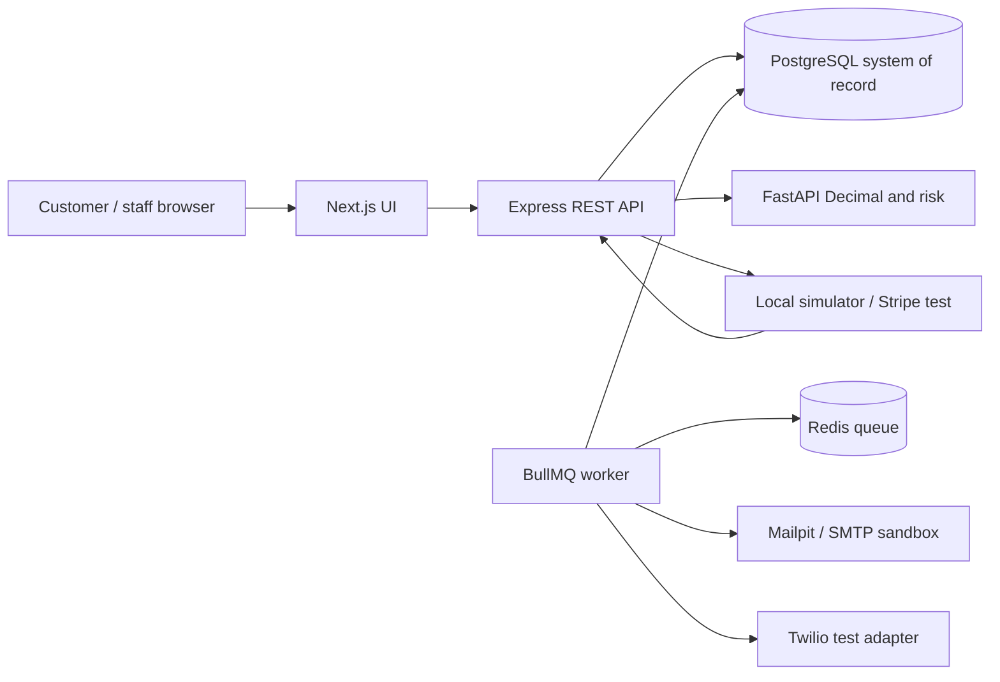
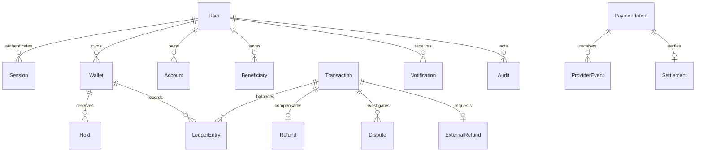
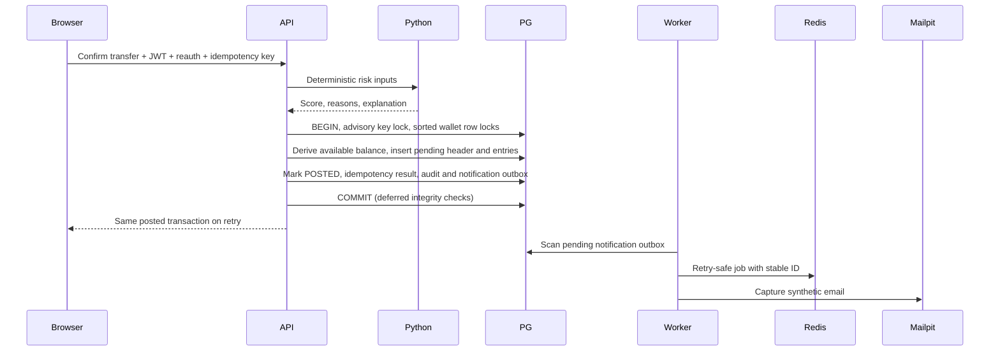

# Architecture and ownership

Express owns identities, accounts, wallets, journal entries, transactions, holds, provider events, disputes, reconciliation, notifications and audit history in PostgreSQL. Next.js consumes the Express API and holds access tokens in memory. Python is stateless: it receives explicit Decimal strings and rule inputs over an internally authenticated HTTP connection. It never owns authoritative financial records. Redis/BullMQ carries retryable jobs; PostgreSQL's notification and external-refund outboxes survive Redis outages and worker restarts.

Migrations are ordered SQL files tracked in SchemaMigration. The schema uses NUMERIC(20,2), foreign keys, CHECK/UNIQUE constraints and measured query indexes. Prisma maps entities and parameterizes queries; tagged raw SQL is deliberately used for row/advisory locks and journal aggregates. Database functions enforce journal invariants independently of TypeScript. The runtime fincore_app role has no schema ownership, no superuser capability and no historical journal UPDATE/DELETE privileges.

Notification email has at-least-once delivery semantics: a crash after SMTP acceptance and before database acknowledgement can resend a message. Stable Message-ID aids downstream deduplication; email is not a financial posting. Financial operations use durable idempotency and unique constraints. Redis loss delays delivery but cannot erase the PostgreSQL outbox. External provider refunds use the same stable provider key on every retry.

Rounding policy is HALF_EVEN to INR two decimal places, with 40-digit JavaScript Decimal precision. Python fees, interest, statement totals and reconciliation use Decimal. UI charts and display-only Intl formatting use numbers and are not authoritative accounting calculations. Risk rules are transparent threshold-based decision support with known false positives, not a fraud verdict or production model.
